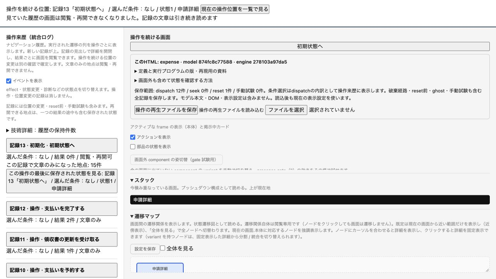

# 最終HTMLの追加ブラウザー検証

2026-10-20。IABの新規タブを作成できることを再確認し、implementation/preview.html をローカルHTTPで開いて実施。製品ソースの修正はなし。

## 下端スクロール

UIから12操作を実行し、記録1を展開したまま履歴ペインの下端へスクロール。見出しへEnterで閉じ、再びEnterで開いた。

| 状態 | 見出しのviewport上端px | scrollTop px | スクロール上限px |
| --- | ---: | ---: | ---: |
| 展開・下端 | 340.5 | 1620 | 1620 |
| 閉じた後 | 476 | 1484.5 | 1484 |
| 再展開 | 476 | 1484.5 | 1620 |

閉じると内容の高さが136px減り、スクロール上限に達して見出しが135.5px動く。小数の丸めを除き下端clampと一致する。再展開では見出し位置を維持。全状態でfocusは「記録1 · 操作 · 下書きを作る」を維持した。

## reset後の復帰

初期地点の「画面を見る」から履歴を閲覧し、「この時点から続ける…」で確認状態にしてから「初期状態へ」を実行。記録13の現在画面へ戻り、閲覧・再開確認は終了。履歴ペインと画面のscrollTopはともに0、表示キーは1:live、focusは「現在の操作位置を一覧で見る」。旧記録の文章は残り、旧地点は閲覧・再開不可と表示された。

## 拡大の検証限界

IABのviewport機能は幅・高さ変更のみで、倍率設定を提供していない。super+plusとctrl+plusを試したが、innerWidth=1280、devicePixelRatio=2、visualViewport.scale=1のままで倍率の変化を確認できなかった。幅変更を拡大の代用にはせず、拡大時の挙動は未検証として残す。

[実測値](browser-residual-measurements.json)。今回の2項目では修正が必要な不具合を認めず、製品ソースは変更していない。以前の機械テスト結果は再実行していない。AIによるブラウザー検証であり、人による使いやすさ評価ではない。

## Chromeでの追加試行

ユーザーの「続けて」に基づき、Chromeの新規検証ウィンドウで同じpreview.htmlをfile URLから開いた。表示メニューの「拡大」とズームコントロールを使い、アクセシビリティツリーで110%、125%、150%、175%、200%を確認した。200%で「下書きを作る」を操作し、ツリーを全量取得した結果、「記録1 · 操作 · 下書きを作る」と操作ボタンへのfocusを確認した。

続いて記録1の展開と画面取得を試みたが、操作が30秒でタイムアウトし、Chromeへの再接続も30秒でタイムアウトした。取得画像と更新後ツリーの対応も確定できていないため、拡大時の表示崩れ、見出し位置維持、閲覧・取消・resetの一連の操作を成功とは扱わない。200%に設定できることと1操作の記録追加までの部分確認に留まる。

操作接続を回復できず、検証用Chromeウィンドウの終了と倍率の100%への復元は未実施。ユーザー側で検証ウィンドウの表示メニューから「実際のサイズ」を選び、閉じる必要がある。製品ソースは変更していない。

## 再接続後の再試行と方針再評価

次の「続けて」でChromeへの接続は復旧した。再開時の倍率は標準で、表示メニューから200%への設定を再確認した。記録1の詳細は後続のAX取得で展開済みと確認できたが、入力直後の応答と後続状態が一致せず、取得直後の要素IDが無効になるエラーも発生した。拡大時の表示位置・閲覧・取消・resetを完了とは扱わない。

同じ操作経路の反復で未達条件が減らないため共通方針に従い再評価した。現方式の継続は証拠の対応を確定できない。保証縮小で完了とすることも推奨しない。推奨は、操作接続の安定性回復後に残件だけを再試験するか、人が同じ最終HTMLを200%で操作して確認すること。現経路の追加試行はここで打ち切り、製品の欠陥とは分類しない。

後片付けでは表示メニューの「実際のサイズ」を実行し、AXの「ズーム: 100%」で倍率復元を確認。専用ウィンドウの閉じる操作後は取得がタイムアウトしたため、終了確認のみ未完了。ソース変更なし。

## 人による残項目の確認結果

200%表示での手順として、履歴の開閉、履歴の閲覧、再開確認の取消、再開確認中からreset後の復帰の4項目を提示した。文字・ボタンの重なり、操作への到達性、実行位置の不変性、表示位置とフォーカスの復帰も確認対象に含めた。ユーザーから「すべて問題なし」と報告を受けたため、これらの残項目は人による確認で完了とする。

根拠はユーザーの確認報告であり、AI操作の成功や新たな自動テスト結果ではない。ブラウザーの種類・版や追加の画像・数値は報告されていない。以前のツール制約の記録は経緯として保持する。製品の追加修正は不要。
