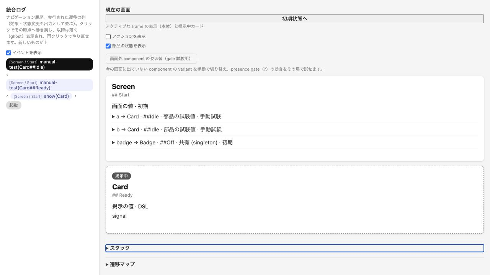

# 共通 Session の実ブラウザ確認と利用評価

2026-10-14。ユーザーの指定で生成 HTML を一時的なローカル HTTP サーバーから Codex の in-app browser で開き、G02/G03 と D02 を実施した。生成物は自己完結 HTML 一枚のまま。ブラウザツールの `file:` 拒否は解消したと扱わず、今回確認した開き方は loopback HTTP とする。

本記録の一覧形式と通信量は `cd7fb9c` の評価時点。その後、ユーザーの追加依頼で [操作一覧を縮小](session-compact-actions.md) し、同じ操作列の出力削減と結果の一致を別記録にした。

## ブラウザ確認

`127.0.0.1` の動的 port に bind し、生成した8 HTMLだけを配信した。main/overlay/包含、分岐実行、gate drawer、stack/frame 木、map の variant 分割、結果途中への seek/redo、ghost からの新規実行、reset、組込み戻ると barrier を実際の画面で確認した。

状態表示は既定 off。Space による on/off で履歴と実行 handle、包含・stack・map の開閉状態が変わらず、checkbox に focus が残った。キーボードで Card の試験値を変更した後は再生成された select に focus が戻った。包含 Card の手動 Idle と overlay Card の DSL Ready を同時に表示し、作用範囲の独立を確認した。singleton の手動／DSL の由来は seek でも復元され、inline と未定義参照には架空の variant が付かなかった。

全8ページを読み込んだ後にサーバーを終了し、残りのモデル操作が動作した。観測資産に外部 URL はなく、localhost の favicon 要求が1件、console の警告・エラーは0件。これは資産観測と読込後の動作確認であり、OS 全体の通信記録ではない。両方の一時サーバーは終了済みで、停止後の接続拒否を確認した。

## CLI と GUI の利用評価

保存済み Sol/Astra の current/proposed は編集せず、正規化、入力エラーからの復帰、保存成功の分岐、文書の切替、競合レビューと取消の目標を順番に実行した。CLI は公開 JSON Lines 入口を同一 process で使い、照会された操作と分岐 ID を client 内に保持した。GUI は表示された control をクリック／キーボード操作し、非公開 Session 呼出しは行っていない。

| モデル | 手順 | 成功 | 意図した guard 確認 | CLI 要求 | 入力 bytes | 出力 bytes |
| --- | ---: | ---: | ---: | ---: | ---: | ---: |
| Sol current | 6 | 6 | 0 | 20 | 1,047 | 90,778 |
| Sol proposed | 13 | 12 | 1 | 42 | 2,218 | 154,718 |
| Astra current | 6 | 6 | 0 | 20 | 1,061 | 45,165 |
| Astra proposed | 10 | 10 | 0 | 32 | 1,702 | 91,718 |
| 合計 | 35 | 34 | 1 | 114 | 6,028 | 382,379 |

操作順・分岐・各手順の現在地と表示 variant は両方式で対応した。Sol proposed のエラー状態では NodeDoubleClick が GUI で無効表示、CLI で `DISABLED_ACTION` となった。意図しない操作特定失敗と分岐誤りは0件。実行中のモデル本文の追加読取と handle／分岐 ID の手動転記も0件だった。前者は tool-call の手集計であり、loader の読取や評価者の事前知識を除外する。後者は client 内での保持を指し、通信量がゼロという意味ではない。

通常応答の縮小は維持されている。一方、全操作一覧の照会40件だけで出力290,500 bytes、明示した全状態4件で71,262 bytesとなった。dispatch 35件は13,291 bytes、既定 query 35件は7,326 bytesだった。操作一覧の簡略表示や絞込みは今後の改善候補になる。GUI は状態のない末端にも注記が並び、状態表示 on では密度が高い。既定 off と折畳みで調整できるが、状態を持つ部品だけの表示も改善候補になる。今回これらの新機能は追加していない。

CLI は列挙された候補と分岐を明示して再実行する用途に向き、GUI は包含・overlay・由来と履歴途中を見比べる用途に向くことを、この操作で確認できた。評価者は既存モデルを知る1 agentで、固定目標による試行である。未知の利用者の発見しやすさ、時間短縮、理解改善は測定していない。自由文 effect の保存や focus も実処理にはならない。

準備中の CLI client 修正2件とブラウザ summary selector の調整は、製品の操作特定失敗に混ぜていない。補足観察では selector の再調整も行った。試験の時刻には tool 操作と記録の時間を含むため、速度比較に使わない。

## 評価からの修正と独立レビュー

評価中、遷移履歴が `goto → Workspace` のみとなり variant の変化を読み分けられない表示退行を確認した。失敗テストの後に実効遷移先の variant を戻し、`goto → Screen / Changed` と `push → Card / Ready` を実ブラウザでも確認した。variant のない遷移先には余分な表示を付けない。修正 commit は `7cb02aa`。

4モデルの利用評価と最初の8 HTMLの記録は `cd7fb9c` に固定する。履歴ラベル修正後のブラウザ確認・54手順70観測点の CLI/生成 GUI 回帰は別記録にした。修正後の対象テストは Session 19、CLI 25、simulator 223 が成功し、build/typecheck も成功。以前の全730テストの成功と、今回の対象267テストの成功を区別する。

実装会話を渡さない Astra が集計、handle 解決、分岐、現在地、画像、限定事項を確認した。on/off・reset・map の前後記録不足は追記して解消し、履歴表示修正も Session 19テストの独立実行で確認した。未解消の actionable finding はない。

## 証跡

- [評価集計](evidence/browser/evaluation.json)、[全 CLI 入出力](evidence/browser/cli-agent-runs.json)、[ブラウザ観察](evidence/browser/browser-observations.json)
- [生成物の識別と hash](evidence/browser/artifact-manifest.json)、[HTTP 要求記録](evidence/browser/http-requests.jsonl)、[サーバー実装](evidence/browser/server.mjs)、[停止観察](evidence/browser/server-lifecycle.json)
- [修正後ブラウザ](evidence/browser/post-label-browser.json)、[修正後 CLI/GUI 回帰](evidence/browser/post-label-regression.json)、[TDD・検証結果](evidence/browser/post-label-validation.json)、[独立レビュー記録](evidence/independent-review.md)

停止の元 tool 出力は転記と明記し、現在の接続拒否の直接観察と区別した。今回確認した環境は macOS の in-app browser 一つで、他ブラウザや支援技術を網羅した保証ではない。
