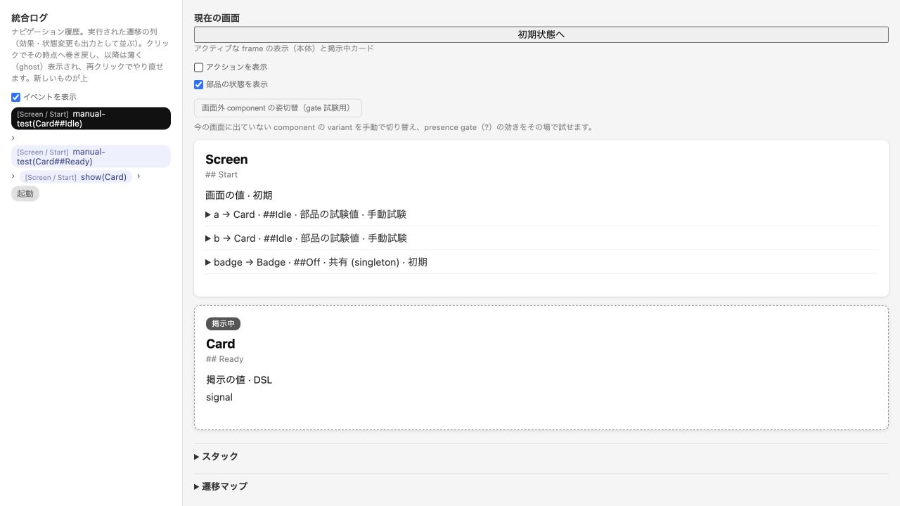

# 操作一覧の縮小と詳細照会

2026-10-14。操作選択に必要な情報だけを一覧へ残し、結果／定義は現在の handle を指定する `action` query に分離した。一覧から直接 dispatch でき、詳細照会は任意。通常の dispatch／既定 query と、過去 observation の詳細照会は維持した。

## 入出力

一覧の入力は従来どおり。

```json
{"id":"a1","command":"query","select":["actions"]}
```

出力 `data.actions.items` の一項目を抜粋すると次の形になる。これは [実入出力の全量](evidence/compact-actions/roundtrip.json) からの一項目で、他の操作と response envelope を省略している。handle はその process／revision 専用で、別の起動へ転記しない。

```json
{"handle":"1e23b45a-19ca-4278-9a2a-00b3333eece8:0:0","actionText":"choose","scope":"component","placement":{"root":"main","path":[]},"host":{"module":"trial-values","component":"Screen","variant":"Start"},"enabled":true,"branches":[{"id":"b0","label":"yes"}]}
```

同名の操作は host／scope／placement で見分ける。配置 source や定義の行番号、gate の対象値と由来、prelude／branch の resultIndex/source、全 results を含む元の interaction AST は詳細 query で読む。

```json
{"id":"x1","command":"query","select":["action"],"handle":"1e23b45a-19ca-4278-9a2a-00b3333eece8:0:0"}
```

成功時は `data.action` に詳細を返す。この例の定義には `pre-effect ; [yes] set(Badge##On) ; show(Badge) ; goto(##Changed)` の全結果が含まれ、source の module を字句解決の基準として保持する。query は実行せず、状態／履歴／revision／operation counter を変更しない。レスポンスを書き換えても Session は変わらない。現在の無効操作も説明を読めるが、古い／別 Session／未知の handle は拒否する。組込み back の詳細に DSL 定義は付けない。

同一 process で一覧→詳細→yes の実行→現在地確認を通した結果は `Screen / Changed`。一覧5項目と組込み back を含む応答1,566 bytes、任意の一操作詳細2,651 bytes、今回出力付き dispatch 612 bytes、既定 query 214 bytesだった（UTF-8・末尾 LF 込み）。選択に詳細は必須でなく、モデル／結果によって詳細のほうが大きくなる。

## 同じ操作列での比較

以前の [4モデル実入出力](evidence/browser/cli-agent-runs.json) と同じ114要求を、現在の一覧から取得した handle／branch IDで再実行した。全35 dispatch の34成功＋意図した拒否1件、各 summary／receipt／最終 state は以前と一致。今回は固定記録の再実行であり、新しい利用者評価や速度の測定ではない。

| モデル | 一覧照会数 | 以前の一覧 bytes | 現在の一覧 bytes |
| --- | ---: | ---: | ---: |
| Sol current | 7 | 69,146 | 18,780 |
| Sol proposed | 15 | 124,950 | 33,379 |
| Astra current | 7 | 25,865 | 8,174 |
| Astra proposed | 11 | 70,539 | 20,978 |
| 合計 | 40 | 290,500 | 81,311 |

一覧は約72%減、全応答は382,379から173,190 bytesへ約55%減った。114要求に新しい詳細 query は加えておらず、一覧のみで選んで実行している。入力は同じ6,028 bytes。[全入出力](evidence/compact-actions/cli-runs.json) と [モデル別集計](evidence/compact-actions/metrics.json) を保存した。候補数、表示名、配置 path、分岐ラベルが増えれば一覧も増える。全件を一定 bytes にする保証や pagination の追加は今回行っていない。

## GUI と検証

GUI は target/gate/source の補助表示に必要な詳細を明示照会する。Astra の独立レビューで、各詳細取得のたびに全候補を再構築する二乗負荷が見つかった。失敗テストを追加した後、現在 revision/context の一覧だけを再利用し、handle は Map で参照するよう修正した。状態変更後と過去 snapshot は分ける。旧 rendering fixture の private モデル／試験値直接変更は本番公開 API ではないため、fixture 内でその cache を失効させた。

公開 CLI と生成 GUI の54手順・70観測点を再照合した。実ブラウザでは分岐、結果途中の seek、状態表示の fold/focus 保持、キーボード select、通常試験値と overlay の分離、Sol proposed のエラー gate を再確認。読込後にサーバーを終了しても操作でき、console の警告／エラーはなかった。一時サーバーは終了済み。



[TDD と検証結果](evidence/compact-actions/validation.json)、[ブラウザ記録](evidence/compact-actions/browser.json)、[CLI/GUI 回帰](evidence/compact-actions/regression.json)、[独立レビュー記録](evidence/independent-review.md) を参照。初版の `protocolVersion:1` 内で契約を具体化しているため、縮小前の保存例は現在の応答 schema と区別する。
