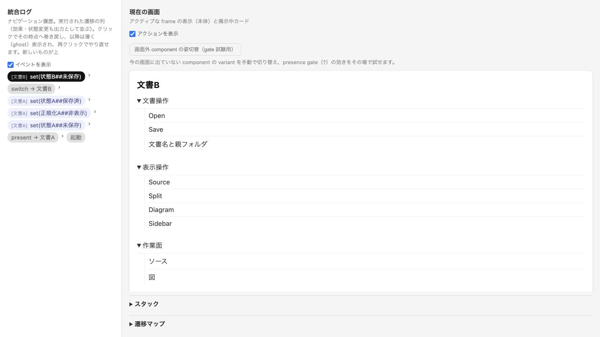
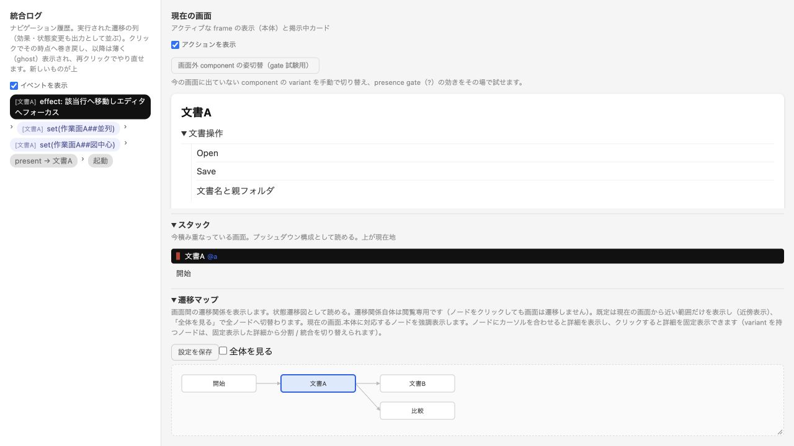

# Astra: shitaeで明らかになったこと、ならなかったこと

2026-10-13の評価時メモ（dogfood.html / shitae-notes.html）をMarkdownへ再構成した公開保存版。効果・負担・改善案は評価者の観察として記録する。PFDSLの一次分析は[評価の入口](../README.md)から参照し、ここには重複保存しない。

有効だったのは、文書を切り替えた時に「何の状態が残るか」を操作列で説明することだった。保存の帰属と、図中心表示からソースへ戻る責務を明確にできた。現状の問題の新規発見、作業時間の短縮、ユーザーの操作成績の改善を証明した試行ではない。

## モデルと効果

| モデル | 目的 | 境界 |
| --- | --- | --- |
| [current](models/current.shitae) / [遷移図](models/current.mmd) | A/Bの代表文書、共通通知、文書固有の検査結果 | 有限の2文書。実ファイルI/Oは実行しない |
| [proposed](models/proposed.shitae) / [遷移図](models/proposed.mmd) | 文書別の状態、作業面切替、競合確認からの復帰 | singletonの複製で有限例を説明する。任意数の文書の設計を証明しない |
| [inline-repro](models/inline-repro.shitae) / [遷移図](models/inline-repro.mmd) | 同じ3要素をinlineと名前付きcomponentで比較 | inlineの表示だけを検討する |

現状モデルの「開く→編集→保存[成功]→切替(B)→編集」では、Bの未保存ドットと共通通知「Saved.」が共存する。提案モデルの同じ操作列は「B.pfdsl — Edited」になる。モデル化前からコード上の疑いがあり、実画面でも確認していた。shitaeの貢献は問題の条件と解消したい状態を再実行できる形にしたこと。

図中心のvariantへ「ノードからソースへ」を置いたことで、ソース再表示と該当位置へのフォーカスの責務を明文化できた。最終モデルで図中心→並列の状態変更を確認した。フォーカスの実移動は自由記述effectであり、製品での検証が必要。外部変更→確認→取消では、元の文書へ戻りChanged on diskが残ることを確認した。実ディスクrevisionの照合は外部条件。

[競合確認の取消の表示記録](evidence/21-proposed-cancel-final.txt)

正規化結果を新しい画面でなく文書別singletonの表示・非表示として表し、編集時のクリアとEscapeを同じ対象へ結び付けた。最終モデルでは文書Aを保ったまま結果が消えた。統合ログの巻戻しと未来のghost表示も試した。これらは既存設計の理解と操作列の共有を助けた。

## 負担と誤り

| 詰まった点 | 対処と分類 |
| --- | --- |
| inline群の子要素がsimulatorで表示されない | 名前付きcomponentへ昇格して書き直した。既存表現の可視化の不足候補 |
| 子部品の裸goto(##並列)が文書Aを変える | set(作業面A##並列)へ修正。SPECの動的receiverに対する作者のモデル誤りであり、意味論の不具合とは扱わない |
| simulateのpipe捕捉がexit 0のまま65,536 bytesで切れる | 通常ファイルへ直接出力して終端と起動を確認。既存CLIの不具合候補 |
| Mermaidだけではsingletonへのsetの関係を読めない | simulatorの状態とログを併用。遷移図の目的に沿った限界 |

保存時に最終ソースを再検査し、原ソースのSHA256を記録した。上の15・20・21番の観察は最終のFormatFlows / FormatFlatラベル調整前だが操作関係は同じ。旧モデルで裸gotoを失敗した観察と、修正後の動作を混同しない。[検証記録](../validation.md)と[候補対応表](../candidates.md)を参照。

改善候補は、CLIの出力完了、inlineの子要素表示、操作直前のreceiver説明、版付き操作履歴の保存、遷移とset関係の補助表示。DSLへレイアウト、寸法、条件式、実ファイル処理を追加する提案ではない。

## 評価の限界

一つのモデル系列を一人の評価者がコードと実画面を知ったうえで作成した。shitaeなしの対照群と同条件の所要時間比較はない。文字・余白・色・寸法・可読性・キーボード/VoiceOver到達性・保存競合の実データ整合性はモデルで判定できない。固定50%という初期仮説は後のCSS/DOM測定で約1:2へ訂正されたが、この発見をshitaeの効果へ算入しない。

自由記述effectはログに出る意図の宣言であり、フォーカスやディスク比較を実行しない。継続利用では、実画面で見つけた一つの往復操作を小さくモデルにし、現状と提案を同じ操作列で比較する用途が適していた。
