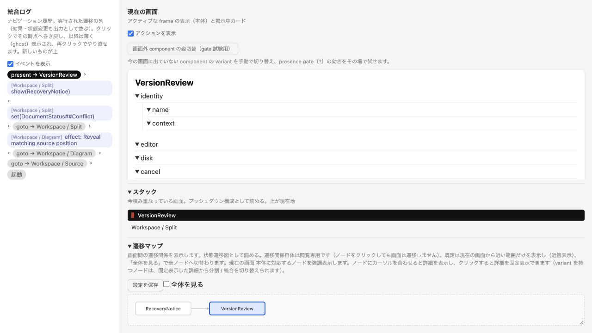
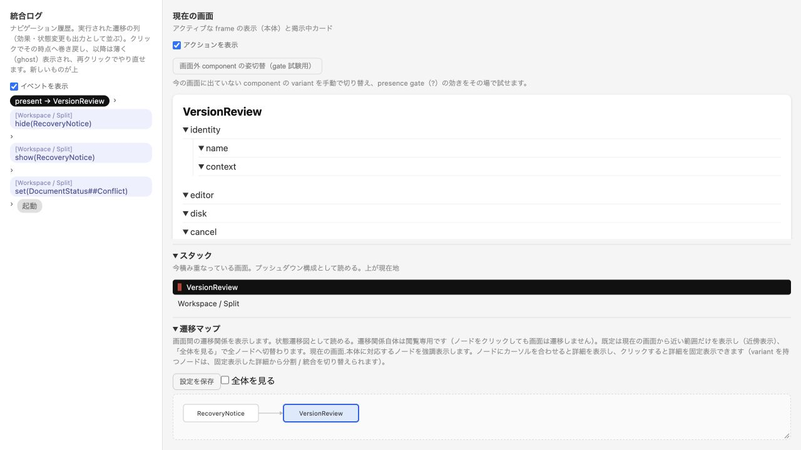

<!-- 評価時メモの公開保存版。リンクと保存状況のみ調整。 -->

# shitae を使った設計検討の効果

shitaeは画面の読みやすさを直接判定する道具にはならなかったが、表示の所属と寿命、戻り先、補助表示が残る条件を具体化するのに役立った。
今回の最も明確な効果は、提案した復旧フロー自身の二重の入口をシミュレータで発見して修正できたことにある。
作業時間の短縮やユーザーの操作成績は比較実験で測っていない。

## 使用したモデル

| モデル | 目的 | 抽象化の境界 |
| --- | --- | --- |
| [current.shitae](models/current.shitae) | 現行の部品包含、全体メッセージ、文書なしの操作 | 一つの代表文書。タブのデータ、フォルダ内容、非同期処理は実装の領分 |
| [proposed.shitae](models/proposed.shitae) | Source、Split、Diagram、文書なしの状態、復旧通知と比較 | モードは表示される部品の集合。比率、位置、文字サイズは記述しない |
| [recovery.shitae](models/recovery.shitae) | 現行の比較確認とキャンセル、保存・採用の関係 | 分岐ラベルは手で選ぶ。ディスクrevision、保存の成立、競合検出は評価しない |

各モデルのHTMLはcheckの後で生成した。評価時にブラウザで試した範囲と、今回の保存作業の検証は[検証記録](../validation.md)で区別する。HTMLは[再実行手順](../README.md)で生成できる。
Mermaidは遷移を見る補助資料であり、画面の見た目や完全な挙動の設計図ではない。
空の末端部品を定義しているためW103警告が残る。
粗いラベルを持つ葉という意図で保持しており、警告なしの完成モデルとは呼ばない。

## 具体例から判断した効果

### 復旧通知が比較中も残る記述を修正した

最初の提案は、外部変更を `show(RecoveryNotice)` で掲示し、Reviewから `present(VersionReview)` を開くだけだった。
実際に歩くと、比較画面と同時に掲示中の通知とReview操作が残り、もう一度比較を開ける入口が見えた。
仕様のoverlayはフレーム木と独立で、presentによって自動で消えない。
文章だけで「比較を開く」と書いていた段階では、通知の寿命を決めていなかった。

提案を `hide(RecoveryNotice); present(VersionReview)` に変更し、KeepEditingでは `dismiss(); show(RecoveryNotice)` とした。
再試行では比較中の掲示カードが消え、キャンセル後は元のSplitと通知へ戻ることを確認した。
これはPFDSL現行アプリに同じ不具合があるという指摘ではなく、今回の提案モデルの修正である。
HTML dialogが背後の操作を抑制することと、shitaeのoverlay意味論を混同しない。
アプリでは比較中の通知を隠すか、見えるが操作不能にするかを実画面で選べる。

### 表示モードを別の文書として扱わずに済んだ

SourceOnlyからDiagramOnlyへ、NodeDoubleClickからSplitへ戻る経路を一つのWorkspaceのvariantとして記述し、ブラウザで歩いた。
何を見せるかと、別文書へ移ることを区別する記述になり、ソースと図が同じ文書に属するという提案の要件を明示できた。
ただしgotoはMonacoのUndoや図のviewportを持たないため、状態保持の実証ではない。
モデルのコメントとレビューの受入条件へ、文書・Undo・選択・図の位置の保持を追加した。

反実仮想として、スクリーンショットだけでも表示切替は提案できたが、図のみの状態からソースへ戻る操作と、切替時に保持するものを同じ判断の中で列挙しにくかった。
この効果は要件の具体化であり、操作が速くなったという結論ではない。

### 文書なしの状態で何を見せるかを点検した

currentのDocumentCommandsを共通部品として残すと、NoDocumentでも保存・整形があるという関係が明確になった。
この関係をwebの実画面で確認し、proposalのNoDocumentではStartActionsだけを表示する案にした。
モデルを歩いてSaveがないことを確認できた。
現行の問題を発見した根拠はwebとcodeで、shitaeは比較案の部品集合を点検する役割を果たした。
メニューで無効にする表現と、主作業領域の開始画面を示す表現は、実装時には別々に判断する必要がある。

## 効果がなかった点と負担

ソースが351pxしかない原因は実画面とCSS実測で分かった。
shitaeは50%と100%の競合を扱わないため、この最優先の問題の診断には役立たなかった。
文字の大きさ、contrast、余白、整列、ウィンドウの密度も実画面へ戻る必要があった。

variantの組合せで文書の保存状態、図の正常性、表示モード、タブを全部表すと量が増える。
今回は用途別に三つへ分け、動的なファイル一覧や文書の複数インスタンスをモデルに持ち込まなかった。
proposedのDocumentStatusは一つの代表文書を示すsingletonであり、実製品ですべての文書に共有する設計ではない。
この説明を省くと、同名部品の状態共有を誤解させる負担がある。

末端のラベルを定義したことで最終版のcheckには30、31、9件のW103が出た。
現状では意図した葉と記述漏れが同じ警告になり、必要な警告を見分ける手間が増えた。
警告をゼロにするために擬似的な挙動を足すことはしなかった。

CLIのsimulate出力をサブプロセスのpipeで受け取ると、exit 0でも65,536 bytesで切れた。
通常ファイルへの直接出力で完全なHTMLを生成し直し、JS構文とブラウザ起動を確認した。
この準備の負担は実際に発生したため、機能メモでは新機能より先に出力の修正候補を記録した。

統合ログ、巻戻し、包含階層、マップ、gate切替は既にあり、新たに要求する必要はない。
一方、今回の試行を別の作業者が再生できる形で保存する機能は見当たらず、スクリーンショットとDOM記録を別途保存した。
モデルの正しさ、実装の一致、ユーザーの分かりやすさはそれぞれ検証が必要である。

独立レビューでは、包含部品に書いた `goto(##Error)` がその部品でなくアクティブなWorkspaceを変える記述を指摘された。
また提案モデルはstatusだけをInvalidにして図を残していたため、保つべき診断挙動と一致していなかった。
代表文書のDiagramViewをsingletonとして `set(DiagramView##Error)` で変更し、図を診断へ置き換える状態に訂正した。
包含部品のaliasを使ったmember gateも指定版のsimulatorでは判定不能扱いになったため、モデルでは実在するcomponent名を参照する形に訂正した。
これはラフな記述の静的検査が通っても、実装との対応が正しいとは限らない具体例であり、モデルを記述・確認する負担として記録する。

## 次に使うなら

最初に実画面と実装から、文書、表示モード、補助表示、比較・確認の境界だけを取り出す。
困った経路を一つ選び、往復、キャンセル、空の状態、補助表示の残存を歩く。
モデルで見つけた候補は実画面へ戻して、見せる／隠す／利用不能にする方法を選ぶ。
状態保持や保存の安全性は実装テストへ、寸法と文字はnativeでの作業観察へ戻す。
モデルが大きくなる前に、具体的な一つの検討問題へ分けることが効果と負担の釣合いを良くする。
