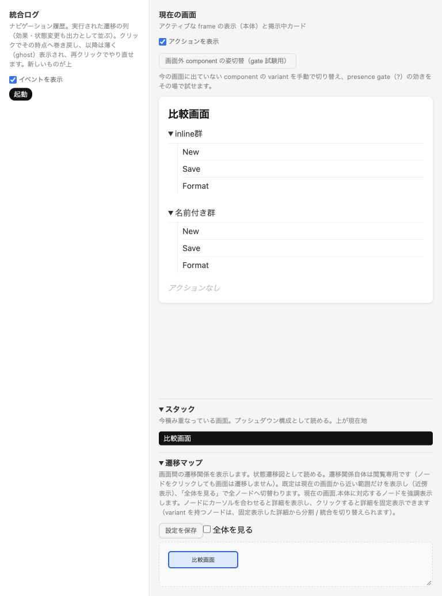
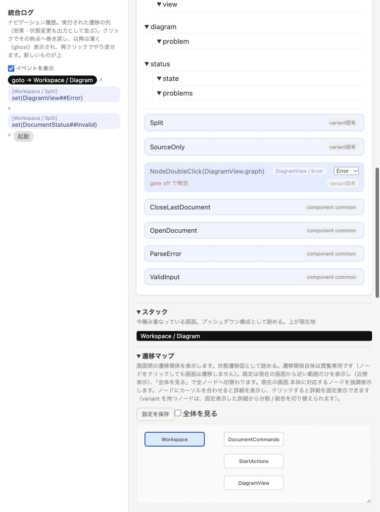

# 再評価の結論

固定版 `e985f4ee58ab76339df5b0f59144e1f1a5da91c8` では、#8・#10・#9 の保存済み再現条件は解消した。#13 は過去の解答を渡さない別コンテキストのagentが適切なモデルを初案から作成でき、そのモデルを主評価者がブラウザで確認した。新規人間利用者への学習効果や時間短縮を実証した試験ではない。

#12 は入れ子の現在状態表示に絞って先に検討することを推奨する。receiverの事前説明は低優先の保留。#11 はテキスト手順で再現できたため即時実装を必須とせず、繰り返し評価の補助として次順位に保留する。製品不具合の新規起票を要する証拠は今回得られていない。

## 修正ごとの判定

| 対象 | 判定と一次証拠 | 境界 |
| --- | --- | --- |
| #8 CLI pipe | **保存再現条件は合格**。Sol currentで3回とも139,281 bytes、通常ファイルとバイト一致。SHA256 `62dab1690386ffb08a14c0fe7448eb44d35d30e7a415f4e3f3ee4ce8772f2bf4`、UTF-8・HTML終端・全埋込みJS構文exit 0。`evidence/validation.json` | macOS/Node26のsubprocess。低速reader・他OSは今回未確認。旧exit0/65,536 bytesとは異なる。旧ファイル137,755 bytesからのサイズ増加は#9/#10の生成JS/inlineデータ変更を含む版差であり、現行版のfile/pipe一致で評価 |
| #10 alias member gate | **保存最小例は合格**。生成UIでAlias/NamedともReady→Error→Readyでon→off→on。Error中クリックは発火せず、Missingのみeffectを追加。Readyに戻すと3操作とも発火。回避策を外したSol派生もError中無効・復帰後Splitへ | 同じbody内のsingleton例。module/衝突alias/通常instance等の全境界をブラウザで網羅したわけではない |
| #9 inline子要素 | **原本は合格**。書換えず生成した比較画面でinline群・名前付き群がNew/Save/Formatを各1回、同じ順に表示。recoveryのchoices/actions、Solのviewも展開 | inlineの入れ子・interaction制約は拡張していない。実行した経路で表示欠落やrenderer起因の不自然な重複は観察しなかった |
| #13 AI_GUIDE | **入口の有効性を限定確認**。独立agentがREADME/AI_GUIDEから通常画面とA/B singleton、遠隔setを選択。初案修正0、check診断0、親の実ブラウザで共有保持/文書分離/通常画面initial/receiverを確認 | E028等の細部はSPEC参照。AI_GUIDEに解答に近いA/B例がある。同じagentモデル系列の1評価で、初心者人間への普遍的効果ではない |

機械検証は7本すべてcheck/mermaid/simulate exit 0、error 0。診断の内容と件数は旧記録に一致。Sol current/proposed/recoveryのW103は30/31/9（計70）、他4本は警告0。保存済み6 Mermaidはバイト一致。alias例は保存Mermaidなしとして新規生成。全7 HTMLでUTF-8・終端・JS構文を確認した。旧runnerの合格終了ではなく、今回の個別assertと観察に基づく。限定VMでもgateとinlineを確認したが、ブラウザ証拠は別に保存した。

## 解消した負担と残る負担

pipe捕捉したHTMLを再度ファイルへ直出力して作り直す回避は不要になった。inlineを名前付きcomponentへ昇格させて内容を表示させる回避も、保存最小例では不要。aliasを実名へ書き換える回避はSol派生モデルの実操作でも外せた。singleton/setの入口とgoto receiverの注意がガイドから得られ、小課題では誤った裸gotoを初案に採用しなかった。

current/proposedの文書帰属、図からソースへの復帰、通知/正規化結果の寿命、取消先は実操作で比較できた。proposedの表示が分かりやすいことは**保存モデルの設計差**であり、今回の処理系修正によってPFDSL製品が改善した証拠ではない。

Solのstatus→stateは有効/無効/競合で同じaliasが見えるため、ログを辿り、モデルでDocumentStatusのvariantと参照先を照合する負担が残った。Astraも作業面のvariant/共有性は画面内の部品名だけから読めない。guideは意味を教えられるが、今の入れ子instanceの実行状態は示せない。状態を説明するaliasへ変更した派生ではvalid/conflict/invalidは読みやすくなったが、実componentとsingletonであることは分からない。

timelineの巻戻し・ghostは同一タブ内の比較に十分だった。共有のためのモデルSHA・手順・分岐・DOM・画像は別ファイルへ記録し、初期状態から操作し直す必要があった。今回Solで11操作、Astraで5操作を再実行して表示一致を確認。所要時間の過去対照や改善率は測定していない。

## 問題・予測差の分類と重複

| 観察 | 分類 / 重複 | 判断 |
| --- | --- | --- |
| status/stateの現在variant・解決後実名・共有性が見えない | **観測しにくさ** / #12と重複 | 正しい実行だが結果理解のためモデルへ戻った。処理系の誤実行ではない |
| 部品内gotoがアクティブ包含画面を変える | **仕様上の意図した制約**。それを部品更新と記述するならモデルの誤り / #12のreceiver部分、#13 | 独立probeをブラウザで確認。ガイドで予測できた。意味変更を求めない |
| recovery ChangedAgainで比較に留まると予測したがConflictへ戻る | **モデルに明記した挙動と評価者の予測差** | dismissと一致。正しいが操作名だけでは戻り先を予測できなかった。モデル誤りと断定するPFDSL受入根拠なし |
| Astraの外部変更確認はChanged on diskを設定しない | **モデルの抽象化・操作名による説明不足** | 保存[外部変更]と比較を開く操作は別。誤実行ではない。原モデルを直していない |
| CLI simulateのHTML stdout保存方法をREADMEから直接読めない | **ガイド不足** / #13とは領域が異なる、全issue一覧に同一候補なし | 独立評価者がUsage/実呼出しで確認。make simulate入口はあるため低優先の記録のみ。新issueは作らない |
| W103が70件、Mermaidからset/包含を読み切れない | **仕様/ツールの意図した表現範囲** / 旧候補で保留 | 診断差分ゼロ、今回は作業を妨げず。警告を埋めたり抑制したりしない。図を完全な状態表示へ拡張する根拠なし |
| 独立Chrome操作のAX/画像不一致 | **評価環境の不整合** | 全列の独立再現を未確認にする。製品不具合・#11の再現失敗の根拠に使わない |

## #12 / #11の採否と最小範囲

| 順位 | 推奨 | 今回の根拠 | 最小範囲 |
| --- | --- | --- | --- |
| 1：#12の入れ子状態 | **限定採用を検討** | ParseError/Conflict/ValidInput後、status/stateが何かをモデルへ戻って確認。gate badgeはDiagramViewのReady/Errorを示すがDocumentStatusを示さない。既存gateパネルにもDocumentStatusなし | 任意の詳細表示で、該当要素のalias→解決後component（必要なmodule識別）、現在variant、singletonマーク。通常instanceを扱う場合は当該包含位置を示し、全instanceを同一状態と見せない。新しい状態変更UI・一般デバッガ・Mermaid拡張は不要 |
| 同issueのreceiver説明 | **後順位で保留** | ガイドと独立probeでgoto/setの作用先は正しく予測でき、保存モデルは既に修正済み。現在のログで実変更先は追える | 需要が再発したら、裸gotoのアクティブcomponentまたはsetの名前付き対象を操作前後に示す短い表示から。全verb可視化を必須にしない |
| 2：#11 | **即時実装の必須性は未成立、反復評価向けに保留** | モデルSHA＋具体操作列＋条件ラベルで親が2系列を再現。timelineは探索に足りる。全列の独立再現は環境で未完了。記録の別管理と11/5操作の再入力は残る | 実装するならローカルsidecarのexport/import、shitae版＋モデルhash、操作の所属/識別、選んだcondition label、手動variant変更、初期化と順次再生。版/操作不一致を停止・報告。条件の推測、実I/O、期待値DSL・自動クラウド保存は不要 |

これは採用判断のための評価報告であり実装着手や設計変更の承認ではない。

## 証拠と限界

静的検査は構文/診断と生成テキストの一致、限定VMは指定関数のgate/描画、実ブラウザは列挙した操作と利用者向け表示、上記の推奨はその範囲からの判断。それぞれを分けた。保存・競合・revision照合・フォーカス移動の実装受入、任意数の文書、OS横断、IME/VoiceOver、全モデル全分岐、低速pipe readerは未確認。条件ラベルは人手で選び、effectは実処理の成功を証明しない。

原モデルと旧証拠は全量SHA256で保全し、旧source-manifestの全20項目も照合した。最後のGit差分は今回の記録ディレクトリの追加だけ。評価版を変更して不具合を修正していない。追加ファイル一覧と保全結果はREADMEから参照できる。

